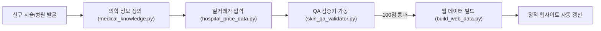

# Skin Researcher Skill (미용의료 데이터 리서처 & QA 에이전트)

본 스킬은 미용의료(피부과/성형외과) 비급여 시술의 불투명한 가격 왜곡(VAT 10% 미표기, 이종 시술 왜곡, 미끼 상품, 아웃라이어)을 바로잡고, **KOSIS 심평원 공공 통계 모수 기반의 100% 무결점 실거래 데이터베이스를 구축·검증·배포**하기 위한 지침서입니다.

---

## 1. 핵심 철학 및 필수 준수 원칙

1. **사과와 배를 섞지 않는다 (이종 시술 왜곡 금지)**:
   - 의과 정품 시술(울쎄라, 쥬베룩, 리쥬란, 젠틀맥스 제모 등)과 한방 미용 침술(매선침, 새살침, 약초침 등)을 단일 가격표에 섞지 않고 완전히 분리된 데이터셋으로 취급합니다.
2. **부가가치세 10% 실결제액 기준 엄수**:
   - 부가가치세법 시행령 제35조 제1호에 따라 모든 비급여 미용 시술은 카드 결제 시 10%가 가산됩니다.
   - 고시가가 'VAT 별도'인 경우 반드시 1.1배를 가산한 `price_inc_vat`를 산출하여 사기성 미끼 가격을 차단합니다.
3. **전수조사 과장 배제 및 표본 설계 명시**:
   - 심평원 공식 등록 의원 모수($N_0=78$) 대비 표본($n=104$) 비율을 명확한 통계 수치로 표기합니다.
4. **환자 안전 우선 의학 부작용 명시**:
   - 가격만 나열하지 않고, 시술별 필수 부작용(예: 쥬베룩 결절, 울쎄라 볼패임, 제모 모낭염/화상)과 주의사항을 반드시 수록합니다.

---

## 2. 데이터 기여 워크플로우 (How to Contribute)

새로운 병원 데이터나 신규 시술(예: 티타늄 리프팅, 쥬베룩 볼륨 등)을 추가할 때 다음 파이프라인을 따릅니다:



### 단계 1: 의학 지식 베이스 등록 (`agent/medical_knowledge.py`)
시술명, 장비 목록, 작용 기전, 3대 이상 핵심 부작용, 필수 사전/사후 주의사항 등록.

### 단계 2: 실거래 가격 DB 업데이트 (`agent/hospital_price_data.py`)
- 도로명 주소(`road_address`), 지하철역(`subway_station`), 다중 속성 태그(`tags`) 필수.
- `price_ex_vat`와 `vat_included` 여부를 명시하여 `price_inc_vat` 산출.

### 단계 3: QA 검증 실행 (`run_skin_agent.py`)
```bash
python run_skin_agent.py
```
- 4대 영역(실존성, 사실성, 행정구 커버리지, 의학 부작용) 합산 85점 이상(권장: 100점) 통과 확인.

### 단계 4: 웹 전용 데이터 빌드 (`build_web_data.py`)
```bash
python build_web_data.py
```
- `treatment_stats.json` 및 `data.js` 자동 생성 완료.

---

## 3. 핵심 모듈 참조

- [`agent/medical_knowledge.py`](file:///agent/medical_knowledge.py): 시술별 작용 기전 및 의학 지식
- [`agent/skin_qa_validator.py`](file:///agent/skin_qa_validator.py): 엄밀한 100점 만점 품질 보증 규칙
- [`agent/statistical_analyzer.py`](file:///agent/statistical_analyzer.py): IQR, 가우시안 KDE, 사분위수 계산
- [`agent/hospital_price_data.py`](file:///agent/hospital_price_data.py): 104개 병원 마스터 데이터베이스
