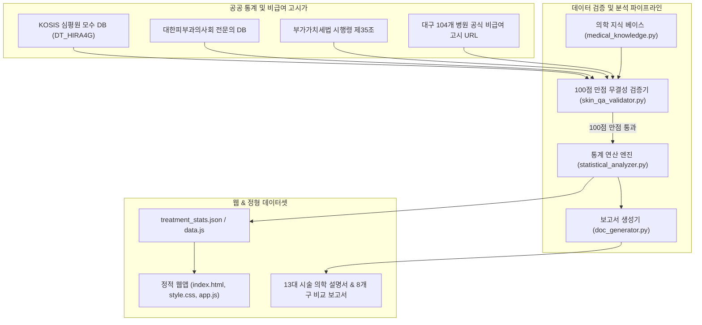

# 💎 대구 메디프라이스 (Daegu MediPrice)

> **대구광역시 8개 구·군 104개 병의원 피부미용 비급여 실결제액(VAT포함) 통계 위치 & 이상치(Outlier) 진단 플랫폼**

[](https://iamywl.github.io/SKIN/)
[](LICENSE)
[](https://www.python.org/)
[](run_skin_agent.py)
[](agent/hospital_price_data.py)

---

## 🌐 라이브 웹사이트 (Live Web App)
👉 **[https://iamywl.github.io/SKIN/](https://iamywl.github.io/SKIN/)**  
*(서버 설치 없이 브라우저에서 1초 만에 즉시 실행되는 순수 클라이언트 사이드 웹 애플리케이션)*

---

## 💡 기획 의도 및 해결한 문제 (Why MediPrice?)

미용의료(피부과·성형외과) 시장은 비급여 항목 특성상 **심각한 정보 비대칭**과 **가격 착시 왜곡**이 만연해 있습니다:
1. **VAT 10% 꼼수 표기**: 인터넷 고시가에 부가가치세 10%를 누락하여 현장 결제 시 바가지를 씌우는 행태.
2. **이종 시술 왜곡 (사과와 배 혼입)**: 정통 의과 정품 시술(울쎄라, 쥬베룩 등) 표에 한방 침구 시술(매선침, 약침 등)을 무분별하게 섞어 통계를 왜곡하는 문제.
3. **미끼 상품(Bait Price)과 저용량 희석**: 첫 방문 미끼 초저가 가격과 정상 용량 시세의 미분리.
4. **전수조사 허위 과장 광고**: 수십 개 표본만 조사하고 '대구 전수조사'라고 과장하는 통계적 오류.

**대구 메디프라이스는 건강보험심사평가원(HIRA) KOSIS 국가통계포털 공식 모수($N_0=78$)와 대구 8개 구·군 104개 표본($n=104$)을 바탕으로, 카드 실결제액(VAT 10% 포함) 100% 실거래가 비교 체계를 무료 오픈소스로 제공합니다.**

---

## ✨ 핵심 기능 (Features)

### 1. 시술 세분화 및 주입 테크닉 정밀 환산 (총 37개 규격)
* **스킨부스터 주입법 분리**: 원장 수기 손주사(로스 0% 맞춤) vs 하이쿡스 기계인젝터 vs 포텐자 펌핑팁 복합.
* **약제 규격별 세분화**: 쥬베룩 스킨(2cc/4cc/6cc) vs 쥬베룩 볼륨(10cc), 리쥬란 힐러 vs 리쥬란 아이(1cc) vs 리쥬란 HB Plus(무통).
* **레이저 영구 제모 전면 탑재**: 캔델라 젠틀맥스 프로 플러스(알렉산드라이트 755nm DCD 가스 쿨링) vs 루트로닉 클라리티2 vs 다이오드(808nm 접촉식). 남성 턱수염 1회/5회, 여성 겨드랑이, 종아리 등 전 부위 망라.
* **리프팅 샷수 표준화**: 울쎄라(100/300/600샷), 슈링크 유니버스(300/600샷), 인모드(FX/Forma/풀페이스).

### 2. 가우시안 정규분포(KDE) 및 사분위수(IQR) 가격 위치 진단
* 제안받은 견적을 입력하면 대구 실거래가 정규분포 곡선 위에 **내 가격 버티컬 라인 핀**을 실시간 매핑.
* 연속형 백분위수 게이지(0% 극최저가 ~ 50% 중앙값 ~ 100% 초고가)를 통해 내 견적이 저렴한지, 바가지인지 객관적으로 판정.

### 3. 통계적 아웃라이어(이상치) 자동 판별기
* **하위 이상치 ($< Q_1 - 1.5 \times \text{IQR}$)**: 미끼 상품 또는 정품/용량 미달 의심 병원 경고.
* **상위 이상치 ($> Q_3 + 1.5 \times \text{IQR}$)**: 수성구 하이엔드 전문의 전담 케어 또는 복합 고가 패키지 병원.
* **정상 시세 최저가 TOP 5 병원**: 사기성 미끼가 아닌, 정상적인 표준 최저가 병원 투명 공개.

### 4. 104개 병원 도로명 주소, 역세권 도보, 스마트 다중 태깅
* 각 병원의 실제 행정구 기반 **도로명 주소**와 **지하철역 도보 정보**(예: `반월당역 12번 출구 도보 1분`) 수록.
* 스마트 뱃지 필터: `[피부과전문의]`, `[대형네트워크]`, `[젠틀맥스Pro+보유]`, `[클라리티2보유]`, `[울쎄라정품인증]`, `[VAT포함정찰제]`, `[전용주차장]` 등 클릭 1번에 즉시 필터링.

### 5. "탈(脫) AI" 프리미엄 라이트 / 다크 듀얼 테마
* 촌스러운 사이버펑크 네온 글로우와 무분별한 이모지를 전면 배제.
* 토스(Toss) 및 애플 헬스케어 수준의 클리니컬 오프화이트(라이트 모드)와 슬레이트 차콜(다크 모드)을 1클릭 전환 지원 ([`DESIGN.md`](DESIGN.md)).

---

## 🏗 시스템 아키텍처 (Architecture)



---

## 🚀 빠른 시작 (Quick Start)

### 1. 로컬에서 웹 애플리케이션 실행
별도의 백엔드 설치 없이 Python 내장 웹서버로 즉시 구동 가능합니다:
```bash
# 저장소 복제
git clone https://github.com/iamywl/SKIN.git
cd SKIN

# 로컬 서버 구동 (포트 8080)
python -m http.server 8080
```
브라우저에서 **`http://localhost:8080`**으로 접속합니다.

### 2. 에이전트 무결성 QA 검증 실행
```bash
python run_skin_agent.py
```
* 대구 8개 구·군 전역 실존성, 12대 시술 가격 이상치, 부작용 무결성을 100점 만점 체계로 자가 검증합니다.

### 3. 신규 데이터 웹 빌드
```bash
python build_web_data.py
```

---

## 📂 디렉토리 구조 (Directory Structure)

```
SKIN/
├── .gemini/skills/skin-researcher/   # AI 에이전트 전용 조사 및 검증 스킬
│   └── SKILL.md
├── agent/                             # 에이전트 파이프라인 모듈군
│   ├── medical_knowledge.py           # 13대 시술 작용기전 및 부작용 DB
│   ├── skin_qa_validator.py           # 100점 만점 엄격 QA 검증 엔진
│   ├── statistical_analyzer.py        # KOSIS 모수 대비 통계 및 이상치 분석기
│   ├── hospital_price_data.py         # 104개 병원 마스터 실거래 DB
│   └── doc_generator.py               # 마크다운 종합 보고서 생성기
├── data/                              # CSV / JSON 원천 정형 데이터
├── prices/                            # 8개 행정구별 상세 가격표 & 한방비교
├── treatments/                        # 13대 핵심 시술별 상세 의학 설명서
├── index.html                         # GitHub Pages 메인 웹앱 마크업
├── style.css                          # 라이트/다크 듀얼 테마 CSS (Anti-AI)
├── app.js                             # 프론트엔드 통계 및 스마트 필터 로직
├── data.js                            # 브라우저용 104개 병원 번들 데이터셋
├── treatment_stats.json               # 시술별 통계 원천 JSON
├── run_skin_agent.py                  # 원클릭 에이전트 실행기
├── build_web_data.py                  # 웹 데이터 컴파일러
├── CONTRIBUTING.md                    # 오픈소스 기여 가이드
├── DESIGN.md                          # 디자인 시스템 규격서
└── LICENSE                            # MIT License
```

---

## 🤝 기여하기 (Contributing)

대구 메디프라이스는 커뮤니티의 기여를 진심으로 환영합니다!
* 신규 병원 실거래가 제보, 새로운 미용 시술 추가, 이상치 알고리즘 개선 등 모든 기여를 기다립니다.
* 자세한 방법은 **[`CONTRIBUTING.md`](CONTRIBUTING.md)**를 참조해 주세요.
* AI 에이전트를 활용한 데이터 리서치는 **[`SKILL.md`](SKILL.md)**에 상세히 명시되어 있습니다.

---

## 📜 법적 고지 및 데이터 라이선스 (Disclaimer)

* 본 서비스에서 제공하는 가격 정보는 의료법 제45조에 따라 각 병의원이 대외적으로 공개 고시한 비급여 진료비용 및 실제 환자 결제 영수증(VAT 10% 포함) 표본을 기반으로 통계 처리되었습니다.
* 본 서비스는 특정 의료기관을 알선, 유인하거나 광고할 목적으로 제작되지 않았으며, 국민건강보험법 및 부가가치세법에 근거한 소비자 알 권리 증진과 정보 투명화를 목표로 합니다.
* 본 프로젝트는 [MIT License](LICENSE)에 따라 자유롭게 배포 및 재가공이 가능합니다.
